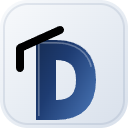
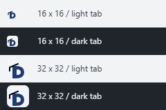
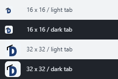
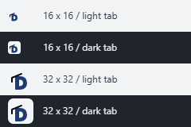

# Lesson favicon proposals

Three asset-only proposals for [issue #52](https://github.com/iricigor/dusan.iric.online/issues/52).
These are review assets, not a selected replacement. The live `favicon.svg`,
generator, tutor agents, published lessons and independent Gems workflow are
unchanged. Fancy versions are proposals for possible later webpage use, not
integrated logos.

| Preview | 01 / Reference enamel | 02 / Upright letterpress | 03 / Rounded satin |
| --- | --- | --- | --- |
| Simple, 128 x 128 |  |  |  |
| Fancy, 128 x 128 |  |  |  |
| Actual 16 x 16 |  |  |  |
| Actual 32 x 32 |  |  |  |
| Native-size light/dark tab samples |  |  |  |

The tab evidence images contain unscaled 16px and 32px favicons against light
(`#f1f3f5`) and dark (`#20242b`) backgrounds. View at 100% browser zoom.
Display device-pixel ratio may still affect physical pixels.

## Differences and tradeoffs

**Reference enamel** retains the approved simple reference geometry exactly:
a low-set, bold D with a generous curved bowl. Its counter is 8 SVG units high,
and its bottom edge has 2 units of tile clearance. The fancy version adds a
porcelain tile, a navy enamel gradient and a clipped fine highlight.

**Upright letterpress** has a taller, narrower D, a straighter shoulder and a
shorter, higher cap that slightly overlaps the upper-left shoulder. Its
10-unit-high counter provides more vertical breathing room, but its
5-unit-wide opening is narrower than the reference. The fancy version uses a
restrained inset tile border and directional blue ink gradient.

**Rounded satin** has softened left corners and a compact, rounder bowl,
with 3 units of bottom clearance. The corner rounding is subtle at 16px;
the bold stem and 8-unit-high counter carry recognition. The fancy version
adds a softly lit tile and blue-to-teal satin shading.

All simple assets use the reference palette: blue `#1e3c72`, black `#000000`
and pale `#f1f5f9`. Every cap consists of a short diagonal stroke and a
downward-hanging left tassel. Each simple/fancy pair shares identical D and
cap/tassel paths; fancy highlights are clipped to the letter. Gradients,
highlights and inset tile borders are absent from the small favicon sources.

## Editable sources

| Concept | Simple SVG | Fancy SVG |
| --- | --- | --- |
| Reference enamel | [Source](reference-simple.svg) | [Source](reference-fancy.svg) |
| Upright letterpress | [Source](upright-simple.svg) | [Source](upright-fancy.svg) |
| Rounded satin | [Source](rounded-simple.svg) | [Source](rounded-fancy.svg) |

All sources use a `0 0 32 32` view box. Simple SVGs have intrinsic 32px
dimensions; fancy SVGs have intrinsic 128px dimensions. PNG previews were
rasterized directly from the corresponding SVG at their named dimensions,
not downscaled from fancy logos.

The local comparison HTML and preview server remain session artifacts,
outside the repository; this directory introduces no runtime dependency.
